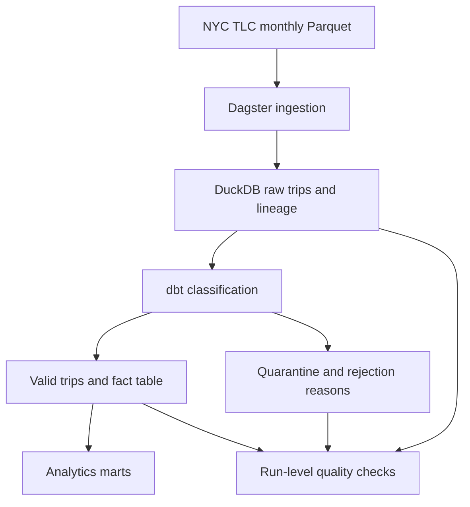

# NYC Taxi Data Platform

[](https://github.com/VasilenData/nyc-taxi-data-platform/actions/workflows/ci.yml)

A reproducible batch pipeline that turns public NYC taxi records into tested analytics tables and retains rejected records with an auditable reason.

**Stack:** Python, SQL, Dagster, dbt, DuckDB, Docker, GitHub Actions.

**Operating status:** Runs locally, in Docker and in CI. Cloud deployment and a continuously operated production service are outside the current scope.

## Results at a glance

Measured on **November 8, 2026** using the actual pipeline, with a new warehouse for each run:

| Dataset | Input rows | Valid fact rows | Quarantined rows | Pipeline wall time | Evidence |
|---|---:|---:|---:|---:|---|
| Full January–October 2023 TLC files | 31,593,944 | 30,694,510 | 899,434 (2.85%) | 78.576 s | [JSON](measurements/full-2026-11-08.json) · [run log](measurements/full-2026-11-08.log) |
| Bundled January/February sample | 30,000 | 29,326 | 674 (2.25%) | 20.735 s | [JSON](measurements/sample-2026-11-08.json) · [run log](measurements/sample-2026-11-08.log) |

Both runs passed the dbt tests, the three platform asset checks, and independent input/raw/valid/quarantine/fact reconciliation. These are public-data project results, not employer production or customer-usage metrics.

The full-data measurement used an AMD EPYC host with an **8-CPU container quota**, **8 GiB container memory limit**, a **4 GB DuckDB limit for ingestion and dbt**, and four dbt threads. That DuckDB setting is not a total process-memory cap; asset-check connections keep their default setting. Input downloads and checksums are excluded from pipeline timing; the OS file cache was not cleared. The sample included the initial dbt parse, while the full run reused the manifest. Complete versions, input checksums and timing conditions are in the JSON files. See [how to reproduce and interpret the benchmarks](docs/BENCHMARKS.md).

## The problem

Raw trip files contain invalid distances, negative fares, impossible durations, missing timestamps and other inconsistencies. Silently dropping those rows makes analytics difficult to reconcile and failures difficult to investigate.

This pipeline preserves raw records, classifies each rejected row by its first failed rule, and builds a fact table and marts from valid records. Its CLI reports a failed run when reconciliation, rejection-rate or coverage checks fail.

## Architecture



- **Ingestion:** reloads a month transactionally without accumulating a second copy; records source month, source filename and load timestamp.
- **Transformation:** an incremental dbt classifier reprocesses changed months. The fact table has an enforced column/type contract and joins the zone lookup seed.
- **Consumption:** marts summarize daily borough activity, hourly demand and data quality.
- **Quality:** raw-to-valid-to-quarantine reconciliation, a configurable rejection-rate limit and coverage checks produce an explicit pass/fail result.

## Run the sample

Use Python 3.11 or later. The sample command uses two bundled 15,000-row extracts and requires no TLC data download.

```bash
git clone https://github.com/VasilenData/nyc-taxi-data-platform.git
cd nyc-taxi-data-platform
python -m venv .venv
source .venv/bin/activate
python -m pip install -r requirements-dev.txt
python scripts/benchmark.py --dataset sample --output measurements/local-sample.json
pytest -q
```

On Windows, activate the environment with `.venv\Scripts\Activate.ps1` in PowerShell.

Open the Dagster UI with Docker:

```bash
docker compose up --build
# http://localhost:3000
```

The quickstart always selects the bundled sample, even if full TLC files have
previously been downloaded. It writes `measurements/local-sample.json` and its
companion `.log`. Choose a new `.json` filename to repeat the measurement; existing
evidence is not overwritten.

For a full-data run, follow [the benchmark commands](docs/BENCHMARKS.md#full-januaryoctober-2023-data). Full mode requires every requested input file in the full-data directory and prevents the loader's automatic fallback to bundled samples. Verify the recorded row counts and checksums when reusing files. For ordinary runs, `TAXI_DATA_DIR` selects the input directory, `TAXI_DB` selects the warehouse, and `TAXI_DUCKDB_MEMORY_LIMIT` optionally caps ingestion/dbt memory.

## Evidence to inspect

| Engineering question | Where to look |
|---|---|
| Can a month be reloaded without double-counting? | [Transactional monthly loader](taxi_platform/ingest.py) and [rerun integration test](tests/test_pipeline.py) |
| Are invalid rows handled deliberately? | [Classification rules](dbt/models/staging/stg_trips_classified.sql) and [quarantine model](dbt/models/staging/trips_quarantine.sql) |
| Does a failed check actually fail the CLI run? | [Quality checks](taxi_platform/checks.py), [runner](run_pipeline.py) and the poisoned-month test in [integration tests](tests/test_pipeline.py) |
| Can the results be reproduced? | [Benchmark runner](scripts/benchmark.py), [measurement guide](docs/BENCHMARKS.md), [CI workflow](.github/workflows/ci.yml) and [Dockerfile](Dockerfile) |
| Can another engineer operate it? | [Runbook: failed checks, backfills and corrected files](docs/RUNBOOK.md) |

The failure-injection test corrupts roughly 40% of a sample month's fares and requires a non-zero pipeline exit:

```bash
pytest -q tests/test_pipeline.py::test_poisoned_month_trips_the_quality_gate
```

## Decisions and current limits

- DuckDB provides a credential-free local warehouse and fast CI. Warehouse-specific cloud deployment and tuning have not been demonstrated here.
- Incremental classification operates at monthly partition level: a changed month is reprocessed as a whole. Fact and mart models are rebuilt by dbt.
- Invalid records remain available in quarantine with their first rejection reason; they are not silently discarded.
- Asset checks can fail a run after tables have been materialized. A separate staging-to-production promotion step would be needed for atomic publication to external consumers.
- CI uses the 30,000-row sample and retains its benchmark artifact for 14 days. The checked-in 31.6-million-row measurement is a separate full-data run.

## Next improvement

Add a tested staging-and-promotion step for consumers, then measure its failure and recovery behavior. Keep the runbook and benchmark evidence aligned with any changes.

## Author

[Vasilen Kanchev](https://github.com/VasilenData) · [Portfolio](https://vasilendata.github.io) · [LinkedIn](https://www.linkedin.com/in/vasilenkanchev/)

Data source: public NYC Taxi and Limousine Commission trip records. Code: [MIT license](LICENSE).
