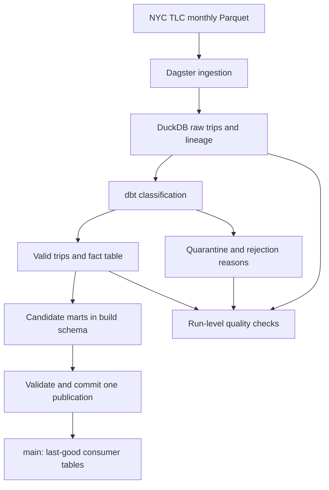

# NYC Taxi Data Platform

[](https://github.com/VasilenData/nyc-taxi-data-platform/actions/workflows/ci.yml)

A reproducible batch pipeline that turns inconsistent public NYC taxi records into reconciled analytics tables. I implemented monthly source validation, an incremental dbt classifier, and an eight-table publication transaction so a failed candidate cannot replace the last good consumer dataset.

**Stack:** Python, SQL, Dagster, dbt, DuckDB, Docker, GitHub Actions.

**Operating status:** Runs locally, in Docker and in CI. An AWS sandbox with scoped roles and query scan controls is prepared and statically validated; actual cloud deployment and a continuously operated production service have not been demonstrated.

**View the result:** [full-data measurement](measurements/full-2026-11-12-final.json) · [correction and recovery exercise](docs/CHANGE_MANAGEMENT.md) · [verified serving-backup restoration](docs/CLOUD_CONTROLS.md)

**Inspect the engineering:** [atomic publisher](taxi_platform/publication.py) · [reviewable change plans](taxi_platform/change_plan.py) · [failure tests](tests/test_publication.py) · [AWS access and cost controls](cloud/aws/template.json)

## Results at a glance

Measured **12 November 2026**, including staged validation and publication of all eight consumer tables, in a new warehouse:

| Dataset | Input rows | Valid fact rows | Quarantined rows | Pipeline wall time | Evidence |
|---|---:|---:|---:|---:|---|
| Full January–October 2023 TLC files | 31,593,944 | 30,694,510 | 899,434 (2.85%) | 140.638 s | [JSON](measurements/full-2026-11-12-final.json) · [run log](measurements/full-2026-11-12-final.log) |

The publication phase took **33.074 s**, including **31.976 s** copying the eight tables and **0.196 s** revalidating publication predicates. Sampled aggregate pipeline RSS peaked at **4.58 GiB**; the final checkpointed warehouse was **8.55 GiB** (raw, build and consumer tables together). The run passed dbt tests, all three platform asset checks and independent input/raw/valid/quarantine/fact reconciliation. These are historical public-data project results, not employer production or customer-usage metrics.

This was a local Windows run, with a **4 GB DuckDB budget separately for ingestion and dbt**, four dbt threads, an existing manifest and a warm input cache. The budget is not a total RSS cap; sampling can miss short peaks or double-count shared pages. Source preparation and downloads are outside the timer; ingestion's integrity checksums are inside it. The [November 8 measurement](measurements/full-2026-11-08.json) used different code and a Linux environment, so the two timings do not establish a speedup or regression. See [measurement boundaries and reproduction](docs/BENCHMARKS.md).

The [six-scenario maintenance exercise](docs/CHANGE_MANAGEMENT.md) additionally demonstrates a January-only correction without changing February's classifier output, rejected schema and quality failures, preserved consumer tables, recovery, and an actual rule change reclassifying both months without reloading their sources. A [seven-scenario stale-plan exercise](docs/change-plan-drift-2026-11-12.json) verifies that same-count edits to raw, incremental or published data invalidate a reviewed plan, while row-order-only changes remain valid. An optional [Iceberg comparison](docs/ICEBERG.md) executes snapshot time travel, rollback and aborted publication on a clearly labelled five-row fixture; its single-table scope is separate from the main eight-table transaction.

## The problem

Raw trip files contain invalid distances, negative fares, impossible durations, missing timestamps and other inconsistencies. Silently dropping those rows makes analytics difficult to reconcile and failures difficult to investigate.

This pipeline preserves raw records, classifies each rejected row by its first failed rule, and builds a fact table and marts from valid records. Its CLI reports a failed run when reconciliation, rejection-rate or coverage checks fail.

## Architecture



- **Ingestion:** reloads a month transactionally without accumulating a second copy; empty or failed replacements roll back to the previous data. Requires the top-level fields used by trip identity, classification and published metrics before replacing a month; historical optional fee fields remain nullable. Records source month, filename and timestamp, plus an append-only `audit.source_loads` entry with the source SHA-256, byte size, logical schema and absent optional fields in the same transaction. Failed schema checks, changed source bytes or failed audit writes preserve the previous rows and successful load history. Hashing before and after ingestion detects ordinary file changes; use immutable input files and a single loader. Older loads are not retroactively fingerprinted.
- **Transformation:** an incremental dbt classifier compares load versions per month, including corrected versions with older timestamps. A changed model revision forces full reclassification of loaded history, preventing old rules from persisting behind unchanged source timestamps. The fact table has an enforced column/type contract and joins the zone lookup seed.
- **Consumption:** marts summarize daily borough activity, hourly demand and data quality.
- **Quality:** reconciliation includes output-only months as well as raw months, so stale valid or quarantined data cannot hide behind a raw-side join. Reconciliation, rejection-rate and coverage checks validate the candidate `build` schema. A downstream publication asset repeats those gates within its snapshot, checks fact/mart totals, then copies the eight managed tables and publication metadata to `main` in one DuckDB transaction. CLI, UI and scheduled transform jobs use this same path.

## Run the sample

Use Python 3.11 or later. The sample command uses two bundled 15,000-row extracts and requires no TLC data download.

```bash
git clone https://github.com/VasilenData/nyc-taxi-data-platform.git
cd nyc-taxi-data-platform
python -m venv .venv
source .venv/bin/activate
python -m pip install -r requirements-dev.txt
python scripts/benchmark.py --dataset sample --output measurements/local-sample.json
pytest -q
```

On Windows, activate the environment with `.venv\Scripts\Activate.ps1` in PowerShell.

Open the Dagster UI with Docker:

```bash
docker compose up --build
# http://localhost:3000
```

The quickstart always selects the bundled sample, even if full TLC files have
previously been downloaded. It writes `measurements/local-sample.json` and its
companion `.log`. Choose a new `.json` filename to repeat the measurement; existing
evidence is not overwritten.

For a full-data run, follow [the benchmark commands](docs/BENCHMARKS.md#full-januaryoctober-2023-data). Full mode requires every requested input file in the full-data directory and prevents the loader's automatic fallback to bundled samples. Verify the recorded row counts and checksums when reusing files. For ordinary runs, `TAXI_DATA_DIR` selects the input directory, `TAXI_DB` selects the warehouse, and `TAXI_DUCKDB_MEMORY_LIMIT` optionally caps ingestion/dbt memory.

## Evidence to inspect

| Engineering question | Where to look |
|---|---|
| Can a month be reloaded without double-counting? | [Transactional monthly loader](taxi_platform/ingest.py) and [rerun integration test](tests/test_pipeline.py) |
| Will a bad replacement destroy the previous load? | [Empty-input and failed-insert rollback tests](tests/test_ingest.py); [out-of-order correction integration test](tests/test_pipeline.py) |
| Are invalid rows handled deliberately? | [Classification rules](dbt/models/staging/stg_trips_classified.sql) and [quarantine model](dbt/models/staging/trips_quarantine.sql) |
| Does a failed check actually fail the CLI run? | [Quality checks](taxi_platform/checks.py), [runner](run_pipeline.py) and the poisoned-month test in [integration tests](tests/test_pipeline.py) |
| Can the results be reproduced? | [Benchmark runner](scripts/benchmark.py), [measurement guide](docs/BENCHMARKS.md), [CI workflow](.github/workflows/ci.yml) and [Dockerfile](Dockerfile) |
| Can a failed candidate replace consumer tables? | [Transactional publisher](taxi_platform/publication.py), [rollback/process-exit tests](tests/test_publication.py) and poisoned-month integration test |
| Can another engineer operate it? | [Runbook: failed checks, backfills and corrected files](docs/RUNBOOK.md) |
| Can a SQL rule change leave stale history? | [Model revision guard](taxi_platform/revision.py), [plan/apply tests](tests/test_change_plan.py) and [executed change exercise](docs/CHANGE_MANAGEMENT.md) |
| What does table-format rollback actually cover? | [Optional Iceberg comparison and measured limits](docs/ICEBERG.md) |

The failure-injection test corrupts roughly 40% of a sample month's fares and requires a non-zero pipeline exit:

```bash
pytest -q tests/test_pipeline.py::test_poisoned_month_trips_the_quality_gate
```

## Decisions and current limits

- DuckDB provides a credential-free local warehouse and fast CI. Warehouse-specific cloud deployment and tuning have not been demonstrated here.
- Incremental classification operates at monthly partition level: a changed month is reprocessed as a whole. Fact and mart models are rebuilt by dbt.
- Invalid records remain available in quarantine with their first rejection reason; they are not silently discarded.
- Consumers read `main.*`; `raw` and `build` are working data and may contain a failed candidate. Publication replaces all managed consumer tables and their version metadata atomically. An exception or process death before commit leaves the previous publication intact.
- This remains a single-writer local DuckDB warehouse, not a concurrent multi-process serving database. Readers needing one version across multiple queries must use a read transaction. Publication copies add storage and runtime overhead; it does not retain old table versions or provide a cloud serving layer.
- CI uses the 30,000-row sample and retains its benchmark artifact for 14 days. The checked-in 31.6-million-row measurement is a separate full-data run.

## Cloud controls and serving recovery

The [cloud extension](docs/CLOUD_CONTROLS.md) provides private versioned S3, distinct release-publisher and aggregate-query roles, encrypted Athena results and an enforced per-query scan cutoff. Both catalog roles are scoped to the selected release's two aggregate tables; the analyst can also read its commit manifest. An explicit byte-budgeted uploader verifies remote checksums before registering immutable release tables.

A [read-only acceptance verifier](taxi_platform/cloud_acceptance.py) checks the assumed query role, enforced workgroup settings, trusted manifest, aggregate object hashes and exact catalog definitions without starting a query. The usage ledger includes failed/cancelled query scans and preserves missing counters as unknown. The [dated offline evidence](docs/cloud-controls-2026-11-13.json) records four baseline regressions and a partition-drift finding resolved after AI cross-review. Infrastructure validation and SDK-boundary tests run in CI; **AWS deployment, live IAM denial tests and cloud query measurements remain unexecuted**. Mocked service responses establish program behavior, not effective AWS access or operating history.

The executed [local backup exercise](docs/cloud-readiness-2026-11-12.json) restored all eight published tables plus their version record from a 3.76 MB Parquet bundle, with zero row differences, identical schemas and passing reconciliations over the 30,000-row sample. Failure tests cover corrupt bundles and abrupt process death during transactional restoration. This is a serving-data backup, not a backup of raw ingestion state or a full-data recovery benchmark.

The [two-query experiment](docs/CLOUD_EXPERIMENT.md) now has an offline plan generator and explicit execution runner: exact account/region/release binding, a bounded fact-read denial probe, local-Parquet reconciliation, idempotent submission and failure journals. Catalog resume checks also reject altered release metadata and formats. These behaviors are verified with local fixtures and mocked SDK responses. The next step still requires an actual account, region and numeric budget: execute the reviewed plan, verify real permissions and record usage, charges and maintenance. **No cloud run or operating history is claimed.**

## Extension: observed pickup forecasting and planning replay

[Forecasting evidence and contract](docs/FORECASTING.md) · [Measured report](docs/forecast/index.html) · [Per-prediction CSV](docs/forecast/predictions.csv)

A separate module aggregates **19.49 million records from six complete TLC files** into 263 zone/day series. A fixed Poisson boosting model competes with a weekly seasonal baseline, with March selection, April interval calibration and a **May–June holdout of 16,043 zone-days**. Observed MAE was **40.23 versus 45.35 pickups per zone-day (11.3% lower)**; learned interval coverage was **88.2% against a 90% target**. The report retains monthly/zone errors, source and artifact checksums, and an explicitly hypothetical capacity-allocation scenario.

This is next-day **historical replay**, assuming prior-day counts are available; monthly public TLC publication cannot feed it live. It forecasts recorded pickups, not unmet demand. Run `python -m taxi_forecast --panel data/forecast/daily_pickups_2023_h1.csv --output /tmp/forecast` after installing `requirements-forecast.txt`. Pipeline measurements above are separate from this modeling run.

## Author

[Vasilen Kanchev](https://github.com/VasilenData) · [Portfolio](https://vasilendata.github.io) · [LinkedIn](https://www.linkedin.com/in/vasilenkanchev/)

Data source: public NYC Taxi and Limousine Commission trip records. Code: [MIT license](LICENSE).
