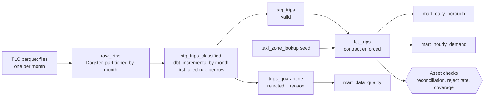

# NYC Taxi Data Platform

[](https://github.com/VasilenData/nyc-taxi-data-platform/actions/workflows/ci.yml)

A small data platform built the way a production one is run: orchestrated, incremental, tested at every layer, and able to **refuse bad data** instead of publishing it.

It ingests the public NYC TLC yellow-taxi trip records (31.6 million trips, Jan to Oct 2023), validates every row, models the clean ones, and keeps every rejected row with the reason.



## What is in it

| Layer | What it does | Why it matters |
|---|---|---|
| **Ingestion** (`taxi_platform/ingest.py`) | Loads one month per run into `raw.trips` with lineage columns. Reloading a month leaves one copy. Tolerates renamed columns. | Safe to re-run after a failure or a late file. |
| **Validation** (`stg_trips_classified`) | Every row gets the first rule it breaks: missing timestamp, non-positive or over-6-hour duration, wrong month, bad distance, negative fare, unknown zone, duplicate. | Bad rows are kept and counted, never silently dropped. |
| **Modelling** (`fct_trips` + 3 marts) | Zone names, duration, speed and tip share. The fact table has an **enforced contract** (names and types). | A schema change fails the build instead of reaching a dashboard. |
| **Testing** | 22 dbt data tests, 1 dbt unit test on the rules, 3 SQL reconciliation tests, 14 pytest tests including an end-to-end run. | Tested at the rule, model, pipeline and platform level. |
| **Quality gate** (`taxi_platform/checks.py`) | Blocking Dagster checks: raw = valid + rejected per month, no month above 10% rejected, fact covers every raw month. | A corrupted month stops the run. A test proves it (see below). |
| **Orchestration** (Dagster) | Raw and dbt models are one lineage graph. Two jobs, monthly schedules, partitions backfillable from the UI. | Operators can see, re-run and backfill every step. |
| **Delivery** | `Dockerfile`, `docker-compose.yml`, CI that lints, parses, runs the full pipeline on a bundled sample and runs all tests. | Anyone can run it with one command. |

## Measured results

Run on one 17-core VM, DuckDB file warehouse, real TLC data.

| | |
|---|---|
| Raw trips loaded (10 months) | 31,593,944 |
| Valid trips in `fct_trips` | 30,694,510 (97.2%) |
| Rejected and kept in quarantine | 899,434 (2.8%) |
| Rejection reasons | bad distance 587,613, bad fare 271,517, implausible duration 27,121, non-positive duration 12,576, out of period 607 |
| Full build, 10 months, load + dbt + all tests and checks | 62 s |
| Reload and rebuild one month | 25 s, results identical (idempotent) |
| Reject rate by month | 2.2% in January rising to 4.5% in September and October |

**A real finding:** the first full run failed my own range test, because exactly one trip lasted precisely 360 minutes while the rule only rejected trips longer than 6 hours. The rule and the test disagreed at the boundary. I changed the rule to reject 6 hours or more so both agree.

**The gate works:** `tests/test_pipeline.py::test_poisoned_month_trips_the_quality_gate` corrupts 40% of a month's fares and asserts that the pipeline exits non-zero. This test caught a bug in my own runner on the first attempt: a failed check with error severity does not fail a Dagster run unless the check is blocking, so a bad month would have gone through. The runner now fails on any failed check and `reject_rate` is blocking.

## Run it

```bash
pip install -r requirements-dev.txt
python run_pipeline.py 2023-01 2023-02      # uses the bundled 15,000-row sample per month, no download
pytest -q                                   # 14 tests, about 45 s

docker compose up --build                   # Dagster UI at http://localhost:3000
```

For real data, set `TAXI_DATA_DIR` to a folder of `yellow_tripdata_YYYY-MM.parquet` files, or leave it empty and months are downloaded from the TLC on demand. `make docs` builds the dbt docs site with column-level lineage.

## Decisions and limits

- **DuckDB, not a cloud warehouse.** One file, no credentials, runs in CI. The dbt models are plain SQL and move to Snowflake, BigQuery or Postgres with small dialect changes (`date_diff`, `strftime`, `isodow`).
- **Incremental by month, not by row.** A reloaded month is reprocessed in full. That is simpler to reason about and cheap here; at billions of rows I would partition by day.
- **The repository sample is synthetic in size only.** It is 15,000 random real rows per month so CI is fast. The numbers above come from the full files.
- **No streaming here.** See [wiki-stream-lakehouse](https://github.com/VasilenData/wiki-stream-lakehouse) for Kafka and Spark Structured Streaming.
- **Not deployed to a cloud.** It runs locally and in Docker.

See [docs/RUNBOOK.md](docs/RUNBOOK.md) for what to do when a check fails.
